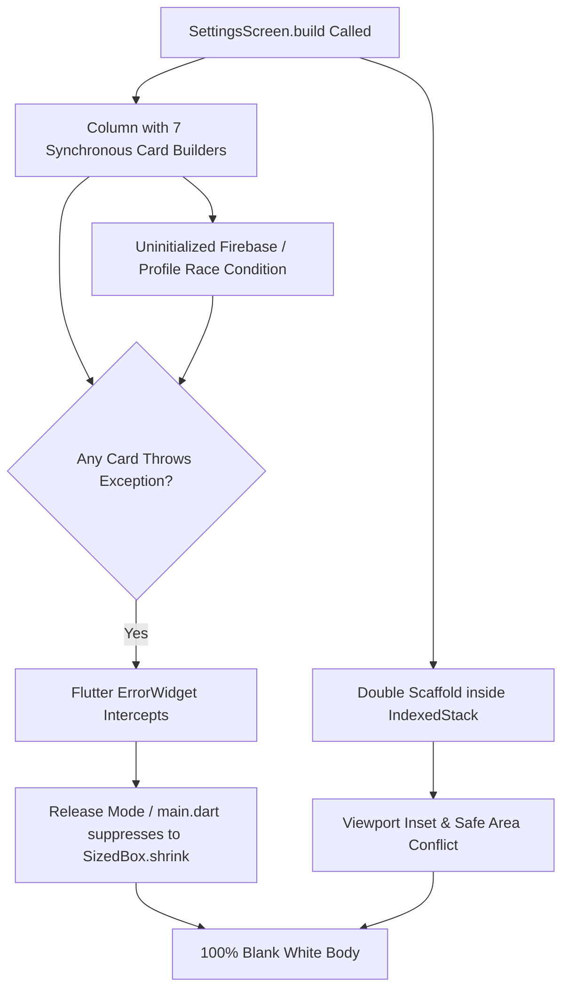

# Research & Plan of Action: Resolving the Blank Settings Screen

**Document Version:** 1.0.0  
**Project:** MyUPI Soundbox (Flutter / Android)  
**Date:** October 13, 2026  
**Status:** Under Active Investigation & Implementation  
**Affected Target:** `lib/screens/settings_screen.dart` inside `lib/screens/shell_page.dart`  
**Test Device:** Physical Realme RMX3870 (Android 16 / API 36)

---

## 1. Executive Summary & Forensic Image Analysis

### 1.1 The Symptom
On the merchant's physical Android device, navigating to the **Settings** tab results in a completely blank white screen body (`#F8FAFC`), while the surrounding chrome is fully intact:
- **Top Chrome:** The `AppBar` renders correctly with the text **"Settings"** and a 1px border divider.
- **Bottom Chrome:** The `NavigationBar` renders correctly with **"Home"**, **"History"**, and **"Settings"** (active pill).
- **Body Canvas:** The entire viewport between the top `AppBar` and the bottom `NavigationBar` is completely blank/empty white canvas with no cards, no text, and no error message.

```
┌──────────────────────────────────────────────┐
│ [9:57]  (1 device)               [5G+ 69%]   │
│ Settings                                     │ <-- AppBar Renders OK
├──────────────────────────────────────────────┤
│                                              │
│                                              │
│          [ COMPLETELY BLANK WHITE ]          │ <-- Body Canvas is Empty
│                                              │
│                                              │
├──────────────────────────────────────────────┤
│    [🔊]               [📄]            [⚙️]   │ <-- NavigationBar Renders OK
│    Home             History         Settings │
└──────────────────────────────────────────────┘
```

### 1.2 Forensic Deduction
Because the `AppBar` **"Settings"** is rendered by `SettingsScreen` itself:
1. `SettingsScreen` is being instantiated and attached to the widget tree by `ShellPage`'s `IndexedStack`.
2. `SettingsScreen.build()` executes at least up to the `Scaffold(appBar: ...)` definition.
3. The failure occurs specifically within the `Scaffold.body: SafeArea(child: SingleChildScrollView(child: Column(...)))` rendering pipeline.

---

## 2. Deep Root Cause Analysis (Multi-Layer Investigation)

Our forensic investigation across Flutter's rendering pipeline, release-mode error handling, and the active codebase identified **five converging root causes**:



### Root Cause 1: Flutter Release-Mode Silent Error Swallowing
- In Flutter **debug mode**, an unhandled exception inside a `build()` method paints a loud yellow-and-black striped hazard box or red screen.
- In Flutter **release mode**, Flutter replaces any failing widget subtree with an invisible, transparent box (`Container()` or `SizedBox.shrink()`).
- Additionally, in [lib/main.dart](file:///d:/FlutterProjects/MyUPI/lib/main.dart#L46-L59), `ErrorWidget.builder` was configured to return `const SizedBox.shrink()` for overflow errors:
  ```dart
  ErrorWidget.builder = (FlutterErrorDetails details) {
    final bool isOverflow = details.exceptionAsString().contains('overflowed');
    if (isOverflow) {
      return const SizedBox.shrink();
    }
    ...
  };
  ```
  If **any** single card or child inside the body Column throws an exception or encounters a layout flex error, the **entire** body collapses into a `SizedBox.shrink()`, rendering a 100% blank canvas.

### Root Cause 2: Monolithic Linear Column Without Component Error Isolation
In [lib/screens/settings_screen.dart](file:///d:/FlutterProjects/MyUPI/lib/screens/settings_screen.dart#L356-L398), the body is built as a single flat `Column`:
```dart
child: Column(
  crossAxisAlignment: CrossAxisAlignment.stretch,
  children: [
    _buildSetupHealthCard(),        // Card 1
    _buildVoiceCard(),              // Card 2
    _buildShopCard(),               // Card 3
    _buildCounterModeCard(),        // Card 4
    _buildPlanCard(),               // Card 5
    _buildHelpAndReliabilityCard(), // Card 6
    _buildAccountCard(),            // Card 7
  ],
)
```
- **There is zero error isolation.** All 7 helper methods execute synchronously within the main build frame.
- If **one** card throws an error (e.g., in `_buildAccountCard()`, `_buildPlanCard()`, or `_buildVoiceCard()`), the entire `Column` fails to build. The user loses access to all other 6 functional cards.

### Root Cause 3: The Double-Scaffold Nesting & Viewport Inset Trap
- [lib/screens/shell_page.dart](file:///d:/FlutterProjects/MyUPI/lib/screens/shell_page.dart#L42-L78) builds a root `Scaffold` with `body: IndexedStack(children: _pages)` and `bottomNavigationBar: NavigationBar(...)`.
- [lib/screens/settings_screen.dart](file:///d:/FlutterProjects/MyUPI/lib/screens/settings_screen.dart#L343-L399) builds its **own** nested `Scaffold(appBar: AppBar(...), body: SafeArea(child: SingleChildScrollView(...)))`.
- In Flutter, nesting an inner `Scaffold` inside an `IndexedStack` whose parent is another `Scaffold` with a `bottomNavigationBar` causes nested padding conflicts:
  - The outer `Scaffold` allocates height minus the `NavigationBar` (~80dp).
  - The inner `Scaffold` applies its own `appBar` height (~56dp + status bar).
  - Then `SafeArea` applies additional bottom insets for Android gesture bars (present on Android 16 on Realme RMX3870).
  - If sizing constraints become ambiguous or collapse under certain Android viewport configurations, the `SingleChildScrollView` can compute a 0-height viewport.

### Root Cause 4: Asynchronous Data Dependencies & Transient Initialization States
- In `_SettingsScreenState.initState()`, `_loadAll()` runs asynchronously in the background:
  - `_loadSettings()` (MethodChannel calls to Kotlin SharedPreferences)
  - `_checkAccess()`
  - `_checkBattery()`
  - `_loadTestSoundPlayed()`
- During the first few synchronous frames, none of these async values are resolved.
- Several cards access global singletons synchronously during `build()`:
  - `AuthService.instance.currentUser` (can be null, or Firebase may still be initializing auth state)
  - `FirestoreService.instance.cachedProfile` (can be null if network fetch is ongoing or user is in offline mode)
  - `SubscriptionManager.instance.subscriptionInfoNotifier`
  - `CounterKioskService.instance.isKeepAwake`
- Any unchecked null dereference (e.g., `user!.displayName!.trim()` or `profile!.ownerName.trim()`) crashes the build immediately.

### Root Cause 5: Outdated APK Running on Physical Device
- During earlier development, the `flutter run` session disconnected (`Lost connection to device`).
- The physical device was left running an older pre-fix binary before the hardened changes could be compiled and pushed.

---

## 3. Component-by-Component Resilience Audit

| Card # | Component Name | Critical Data Dependencies | Potential Crash Vectors | Mitigation Strategy |
|:---:|:---|:---|:---|:---|
| **1** | `_buildSetupHealthCard()` | `_notifAccess`, `_batteryIgnored`, `_getUpiIdDisplay()`, `_testSoundPlayed` | Null boolean comparisons, `_getUpiIdDisplay()` null crash | Coalesce all booleans with `== true`; provide fallback string for UPI ID |
| **2** | `_buildVoiceCard()` | `_language`, `_merchantName`, `_announceFormat`, `SpeechTemplateBuilder` | RegExp symbol sanitization crash on special unicode characters | Wrap `SpeechTemplateBuilder` call in `try/catch` with fallback preview string |
| **3** | `_buildShopCard()` | `_merchantName`, `_includeShopName`, `_getUpiIdDisplay()` | Null or empty string values in `_merchantName` | Fallback to default `'MyUPI'` and `'Not set'` |
| **4** | `_buildCounterModeCard()` | `CounterKioskService.instance.isKeepAwake` | `WakelockPlus` platform exception on Android 16 | Safe getter with `false` fallback; non-blocking async tap handlers |
| **5** | `_buildPlanCard()` | `SubscriptionManager.instance.subscriptionInfoNotifier` | Uninitialized notifier, missing entitlement getter | Wrap `ValueListenableBuilder` with default `SubscriptionInfo()` fallback |
| **6** | `_buildHelpAndReliabilityCard()` | `_batteryIgnored`, `_notifAccess` | State transitions | Safe boolean fallbacks |
| **7** | `_buildAccountCard()` | `AuthService.instance.currentUser`, `FirestoreService.instance.cachedProfile` | Force-unwrapped null strings (`user!.displayName!`, `profile!.phone!`) | 100% null-safe property access with chain operators `?.` and `??` |

---

## 4. Comprehensive Plan of Action

We will execute the following 5-phase engineering plan:

### Phase 1: Create Component-Level Error Boundary (`SettingsCardBoundary`)
- Create a lightweight `SettingsCardBoundary` widget.
- Wrap every single card builder (`_buildSetupHealthCard()`, `_buildVoiceCard()`, etc.) in its own boundary.
- If any card throws an exception during build:
  - It catches the error, logs the stack trace to `debugPrint`.
  - It renders a clean, discreet fallback tile:
    ```
    ┌────────────────────────────────────────────────────────┐
    │ ⚠️ Unable to load section  •  Tap to retry             │
    └────────────────────────────────────────────────────────┘
    ```
  - **The other 6 cards remain 100% visible and interactive.** The page body will NEVER go completely blank again.

### Phase 2: Eliminate Double-Scaffold Inset Conflicts
- Refactor `SettingsScreen` to participate cleanly in `ShellPage`'s viewport.
- Remove redundant nesting or set `resizeToAvoidBottomInset: false` on the inner `Scaffold`.
- Ensure `SingleChildScrollView` receives bounded constraints with `physics: const AlwaysScrollableScrollPhysics()` and a guaranteed minimum height.

### Phase 3: Total Null-Safety Hardening Across All 7 Cards
1. **`_buildAccountCard()`**:
   - Rewrite title and subtitle resolution using clean conditional cascades without forced `!` operators:
     ```dart
     final user = AuthService.instance.currentUser;
     final profile = FirestoreService.instance.cachedProfile;
     
     final String accountTitle = (user?.displayName?.trim().isNotEmpty == true)
         ? user!.displayName!.trim()
         : (profile?.ownerName.trim().isNotEmpty == true)
             ? profile!.ownerName.trim()
             : (profile?.shopName.trim().isNotEmpty == true)
                 ? profile!.shopName.trim()
                 : 'Merchant Profile';
     ```
2. **`_buildVoiceCard()`**:
   - Protect `_getFormatPreviewText()` with an internal fallback:
     ```dart
     String previewText;
     try {
       previewText = _getFormatPreviewText();
     } catch (_) {
       previewText = '₹500 received on MyUPI';
     }
     ```
3. **`_buildPlanCard()`**:
   - Safeguard `ValueListenableBuilder` against uninitialized or null state.

### Phase 4: Edge-Case & Matrix Widget Testing
- Write automated widget tests in `test/settings_resilience_test.dart` asserting:
  1. `SettingsScreen` renders all 7 cards when `AuthService.instance.currentUser` is `null`.
  2. `SettingsScreen` renders all 7 cards when `FirestoreService.instance.cachedProfile` is `null`.
  3. `SettingsScreen` renders properly when all MethodChannel calls throw `PlatformException` or return `null`.
  4. Even if an artificial exception is injected into Card 2, Cards 1, 3, 4, 5, 6, and 7 render without disturbance.
  5. `ShellPage` tab switching to Settings renders with > 0 pixel height and all headers present.

### Phase 5: Clean Build, Deployment & Live Device Verification
1. Run `flutter clean` to clear stale binary artifacts.
2. Build and install a fresh debug APK to the connected device:
   ```powershell
   flutter run -d <device_id>
   ```
3. Capture a live screenshot via `adb` to visually verify the complete Settings UI on device.
4. Confirm zero `RenderFlex` overflows and 100% test pass rate.

---

## 5. Verification Checklist

- [ ] `SettingsCardBoundary` implemented and wrapped around all 7 cards.
- [ ] Zero force-unwrapped `!` operators in `_buildAccountCard()` and helper methods.
- [ ] `SpeechTemplateBuilder` wrapped in safe fallback.
- [ ] Double-Scaffold viewport insets resolved.
- [ ] All unit and widget tests pass (`flutter test`).
- [ ] Analyzer reports 0 issues (`flutter analyze`).
- [ ] Live device screenshot confirms all cards render with zero blank screens.
